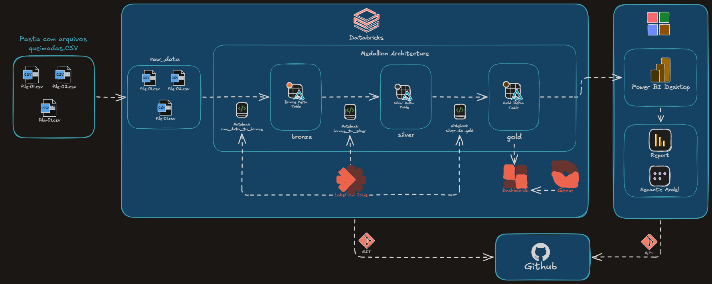

# Projeto-queimadas
## 📌 Visão geral

- **Objetivo:** Consolidar arquivos anuais de queimadas para análises em ferramentas de BI's
- **Fonte dos dados:** https://dataserver-coids.inpe.br/queimadas/queimadas/focos/csv/anual/Brasil_sat_ref/
- **Destino:** tabelas Delta consumidas pelo Power BI
- **Frequência de atualização:** Diáriamente pelos workflows do Databricks

#### Planejamento/Estruturação do projeto


## 🧰 Tecnologias e ferramentas

#### Linguagens


#### Plataforma e armazenamento


#### Visualização e BI


#### Versionamento e documentação


## 🏗️ Arquitetura

```
Arquivos brutos (pasta no Databricks - raw_data)
        │
        ▼
   [Bronze]  → ingestão fiel dos arquivos, sem alterações
        │
        ▼
   [Silver]  → limpeza, padronização de tipos, deduplicação
        │
        ▼
   [Gold]    → tabelas agregadas e modeladas para análise
        │
        ▼
    Power BI | Dashboard (Databricks)
```

## 📂 Estrutura do projeto

```
Projeto-queimadas/
├── documentos/
│   ├── Excalidraw - Arquitetura projeto queimadas.excalidraw   # arquivo editável do diagrama
│   └── Excalidraw - Arquitetura projeto queimadas.png          # imagem da arquitetura
├── notebooks/
│   ├── 01 - nb_bronze/
│   │   └── nb_raw_data_to_bronze      # ingestão dos dados brutos (Bronze)
│   ├── 02 - nb_silver/
│   │   └── nb_bronze_to_silver        # limpeza e padronização (Silver)
│   └── 03 - nb_gold/
│       └── <nb_silver_to_gold>        # agregações para o Power BI (Gold)
└── README.md
```